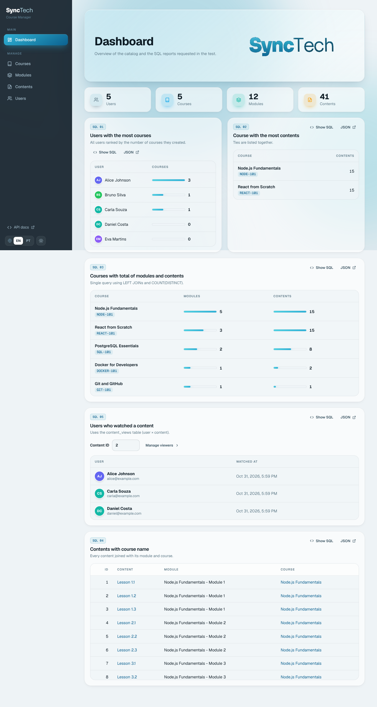
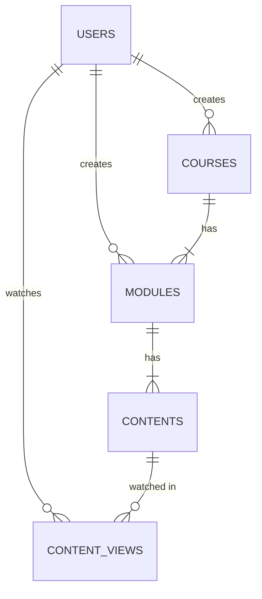
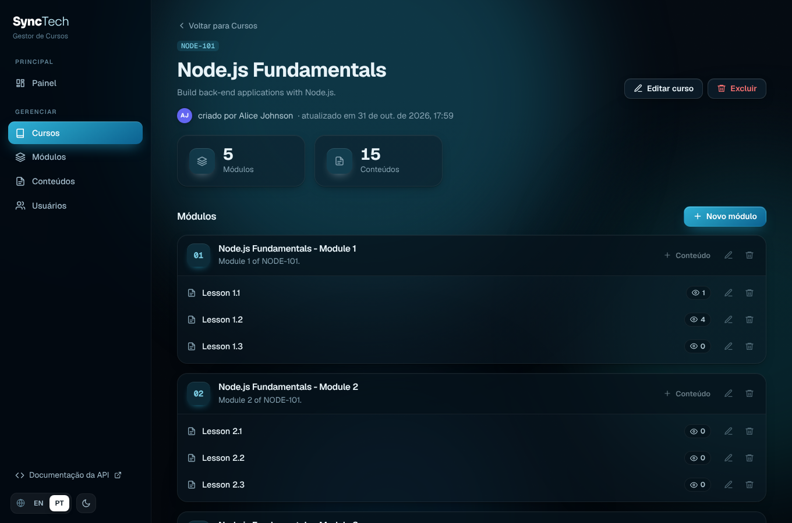
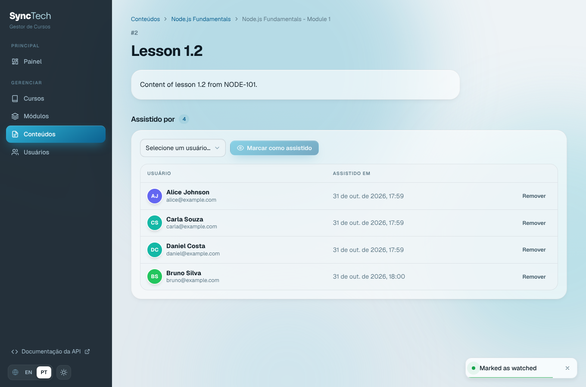
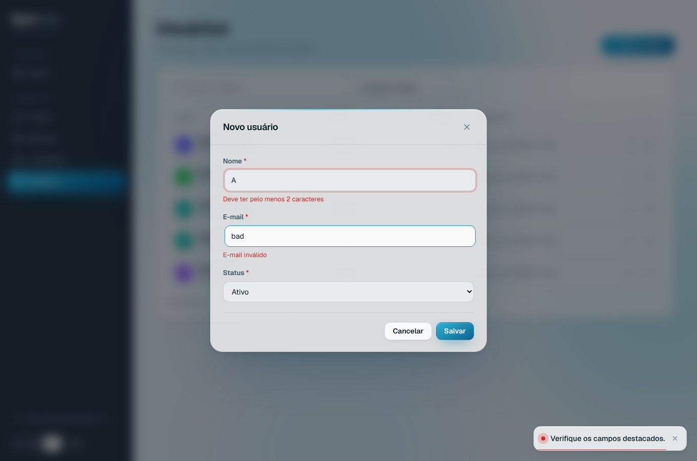

# Course Manager

Online course management system built for the **XPTO practical test (Node.js + React.js)**.

- **API**: Node.js, Express 5, Knex (migrations and seeds), PostgreSQL, Zod validation
- **Web**: React 18, React Router, Vite, Framer Motion. SyncTech visual identity (glass surfaces, 3D animated logo, page and list transitions), English / Português (BR) and light / dark theme chosen in the sidebar. Animations respect the OS "reduce motion" setting
- **Docs**: OpenAPI 3 / Swagger UI at `/api/docs`, Postman collection with tests
- **Infra**: Docker (multi-stage), Docker Compose, Heroku (container stack), GitHub Actions CI
- **Live demo**: https://leohamil31.github.io/XPTO-TI/ (static, see [GitHub Pages](#github-pages-static-demo))



## Contents

- [Quick start (Docker)](#quick-start-docker)
- [Local development](#local-development)
- [Database (DER, migrations, seeds)](#database)
- [SQL reports](#sql-reports)
- [Who watched a lesson](#who-watched-a-lesson-content-id--2)
- [API](#api)
- [Tests](#tests)
- [Deploy to Heroku](#deploy-to-heroku)
- [GitHub Pages (static demo)](#github-pages-static-demo)
- [Project structure](#project-structure)

## Quick start (Docker)

Requirements: Docker with Compose (on Windows use WSL2 + Ubuntu).

```bash
docker compose up --build
```

| URL | What |
| --- | --- |
| http://localhost:3333 | React app |
| http://localhost:3333/api/docs | Swagger UI |
| http://localhost:3333/api/docs.json | OpenAPI document |

The container runs the migrations and the seeds on start. Seeds truncate the tables,
so use `RUN_SEEDS=false docker compose up` to keep your data between restarts.

## Local development

Requirements: Node.js 20+ and PostgreSQL 14+ (or only the database from Compose: `docker compose up db`).

```bash
cd backend
cp .env.example .env
npm install
npm run migrate
npm run seed
npm run dev          # http://localhost:3333
```

```bash
cd frontend
npm install
npm run dev          # http://localhost:5173 (proxies /api to :3333)
```

Useful scripts (backend): `npm run db:reset` (rollback + migrate + seed), `npm run migrate:rollback`, `npm test`.

## Database

Full diagram and design decisions: **[docs/DER.md](docs/DER.md)**.



**Migrations** (`backend/src/db/migrations`, Knex): `users`, `courses`, `modules`, `contents`, `content_views`.
Every table has `created_at`/`updated_at`; `courses` and `modules` have `user_id` pointing to the user who created them.

**Seeds** (`backend/src/db/seeds/01_initial_data.js`), deterministic:

| Course | Modules | Contents per module | Total contents | Author |
| --- | --- | --- | --- | --- |
| NODE-101 Node.js Fundamentals | 5 | 3 | 15 | Alice |
| REACT-101 React from Scratch | 3 | 5 | 15 | Bruno |
| SQL-101 PostgreSQL Essentials | 2 | 4 | 8 | Alice |
| DOCKER-101 Docker for Developers | 1 | 2 | 2 | Alice |
| GIT-101 Git and GitHub | 1 | 1 | 1 | Carla |

Plus 5 users (one inactive) and 6 content views; content **2** was watched by Alice, Carla and Daniel.
Each module must have at least one content, so "a course with 5 modules and 3 contents" was read as
3 contents *per module*. Two extra smaller courses make every table have at least 5 records.

## SQL reports

All queries are in **[backend/sql/reports.sql](backend/sql/reports.sql)**, exposed by the API under
`/api/reports/*` and shown in the **Dashboard** screen (each report has a "Show SQL" button).

**SQL 01 - users with the most courses**

```sql
SELECT u.id, u.name, u.email, COUNT(c.id) AS total_courses
FROM users u
LEFT JOIN courses c ON c.user_id = u.id
GROUP BY u.id, u.name, u.email
ORDER BY total_courses DESC, u.name ASC;
```

**SQL 02 - course with the most contents** (`RANK()` returns every course tied in first place;
with the seed data NODE-101 and REACT-101 both have 15)

```sql
SELECT id, code, title, total_contents
FROM (
  SELECT c.id, c.code, c.title,
         COUNT(ct.id) AS total_contents,
         RANK() OVER (ORDER BY COUNT(ct.id) DESC) AS position
  FROM courses c
  LEFT JOIN modules m ON m.course_id = c.id
  LEFT JOIN contents ct ON ct.module_id = m.id
  GROUP BY c.id, c.code, c.title
) ranked
WHERE position = 1;
```

**SQL 03 - all courses with total of modules and contents (1 query)**

```sql
SELECT c.id, c.code, c.title,
       COUNT(DISTINCT m.id) AS total_modules,
       COUNT(ct.id)         AS total_contents
FROM courses c
LEFT JOIN modules m ON m.course_id = c.id
LEFT JOIN contents ct ON ct.module_id = m.id
GROUP BY c.id, c.code, c.title
ORDER BY c.id;
```

**SQL 04 - all contents with the course name (1 query)**

```sql
SELECT ct.id, ct.title AS content_title, m.title AS module_title, c.title AS course_title
FROM contents ct
INNER JOIN modules m ON m.id = ct.module_id
INNER JOIN courses c ON c.id = m.course_id
ORDER BY c.id, m.id, ct.id;
```

## Who watched a lesson (content ID = 2)

Extra columns would not work: one content is watched by many users and one user watches many
contents (N:N). So a new table was created:

```text
content_views (id, user_id FK, content_id FK, watched_at, created_at, updated_at)
UNIQUE (user_id, content_id)
```

```sql
SELECT u.id, u.name, u.email, cv.watched_at
FROM content_views cv
INNER JOIN users u ON u.id = cv.user_id
WHERE cv.content_id = 2
ORDER BY cv.watched_at, u.name;
```

In the app, open a content (e.g. `/contents/2`) to mark/unmark users as viewers.

## API

Base path `/api`. Full contract in Swagger (`/api/docs`) and in
[docs/postman/course-manager.postman_collection.json](docs/postman/course-manager.postman_collection.json).

| Method | Route | Description |
| --- | --- | --- |
| GET | `/users`, `/courses`, `/modules`, `/contents` | Paginated list (`page`, `limit`, `search` + filters) |
| GET | `/{resource}/:id` | Get one |
| POST | `/{resource}` | Create |
| PUT | `/{resource}/:id` | Replace |
| PATCH | `/{resource}/:id` | Partial update |
| DELETE | `/{resource}/:id` | Delete |
| GET | `/contents/:id/views` | Users who watched the content |
| POST | `/contents/:id/views` | Mark as watched `{ "user_id": 1 }` (idempotent) |
| DELETE | `/contents/:id/views/:userId` | Unmark |
| GET | `/reports/users-most-courses` | SQL 01 |
| GET | `/reports/course-most-contents` | SQL 02 |
| GET | `/reports/courses-summary` | SQL 03 |
| GET | `/reports/contents-with-course` | SQL 04 |
| GET | `/reports/content-viewers/:id` | SQL 05 |
| GET | `/health` | Health check |

Filters: `users?status=`, `courses?user_id=`, `modules?course_id=&user_id=`, `contents?module_id=&course_id=`.

Lists return `{ "data": [...], "meta": { "page", "limit", "total", "total_pages" } }`.
Errors return `{ "error": { "status", "message", "details" } }`:
`400` validation, `404` not found, `409` unique/foreign key violation (e.g. deleting a user who authored courses).

**Postman**: import the collection; `baseUrl` defaults to `http://localhost:3333/api`. Running the whole
collection (or `npx newman run docs/postman/course-manager.postman_collection.json`) creates a user,
course, module and content, exercises every route and cleans up after itself.

## Internationalization and theme

The interface is available in **English** and **Português (BR)**. Switch with the `EN | PT` control at the
bottom of the sidebar. The first visit follows the browser language, and the choice is saved in `localStorage`.
Translations live in `frontend/src/i18n/` and use a small dependency-free provider: `t('key', { params })`,
date formatting with `Intl`, and translation of the API's validation and constraint messages.
The API itself stays in English, as the test requires.

The sun/moon button switches between light and dark themes. Its first value follows the operating system.

## Tests

Integration tests (Node test runner + Supertest) run against a real PostgreSQL database
(`TEST_DATABASE_URL`, default `courses_test`), recreating schema and seeds:

```bash
cd backend && npm test
```

GitHub Actions (`.github/workflows/ci.yml`) runs the API tests with a Postgres service, builds the
front-end and builds the Docker image.

## Deploy to Heroku

The app is a single container: Express serves the API and the React build.

```bash
heroku create <app-name>
heroku stack:set container
heroku addons:create heroku-postgresql:essential-0
heroku config:set DATABASE_SSL=true
git push heroku main
heroku run ./node_modules/.bin/knex seed:run   # optional sample data
```

`heroku.yml` builds the `Dockerfile` and runs the migrations in the release phase.
Heroku provides `PORT` and `DATABASE_URL`.

## GitHub Pages (static demo)

GitHub Pages only hosts static files, so it cannot run Node.js or PostgreSQL. The Pages build
(`.github/workflows/pages.yml`) compiles the React app with `VITE_DEMO=true`: requests are handled by
`frontend/src/api/mock.js`, an in-browser implementation of the same API (routes, validation, unique and
foreign key rules, cascades, reports) loaded with the same seed data and persisted in `localStorage`.
The normal build does not include it. Swagger is published at `/swagger/`.

Setup once: **Settings → Pages → Build and deployment → Source: GitHub Actions**. Every push to `main`
deploys again.

## Project structure

```text
backend/
  knexfile.js
  sql/reports.sql             # SQL 01-05
  src/
    app.js, server.js
    config/env.js
    db/migrations, db/seeds
    routes/                   # REST routes (generic CRUD router + reports + views)
    controllers/
    services/                 # data access (Knex), report queries
    validators/schemas.js     # Zod schemas
    middlewares/              # validation, error handling
    docs/openapi.yaml         # Swagger / OpenAPI 3
  test/
frontend/
  src/
    api/client.js             # fetch wrapper
    resources.jsx             # columns/fields/filters of each CRUD screen
    i18n/                     # en.js, pt-BR.js and the I18nProvider (t(), dates, API error messages)
    pages/                    # Reports, ResourcePage, CourseDetail, ContentDetail
    components/, hooks/
docs/
  DER.md, postman/, screenshots/
Dockerfile, docker-compose.yml, heroku.yml
```

## Screenshots

| Course (PT-BR, dark) | Content viewers (PT-BR) | Validation (PT-BR) |
| --- | --- | --- |
|  |  |  |
