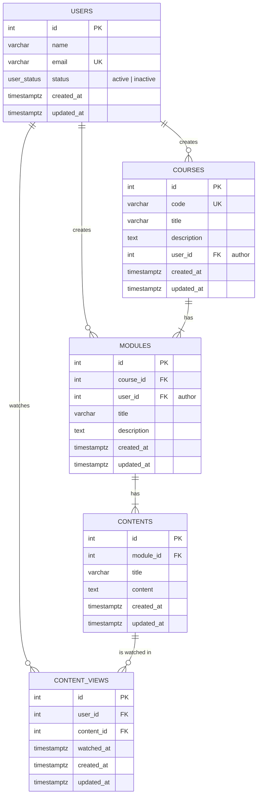

# Entity Relationship Diagram (DER)

## Design decisions

| Decision | Reason |
| --- | --- |
| `courses.user_id` and `modules.user_id` reference `users` with `ON DELETE RESTRICT` | Required by the test (who inserted the record). A user who authored content cannot be deleted silently; the API returns `409`. |
| `modules.course_id` and `contents.module_id` use `ON DELETE CASCADE` | Modules and contents do not exist without their parent. |
| `courses.code` and `users.email` are `UNIQUE` | Business keys. Codes are stored uppercase and emails lowercase by the API. |
| `user_status` is a native PostgreSQL enum | The database guarantees only valid statuses. |
| Watch tracking uses a new N:N table `content_views` | A content is watched by many users and a user watches many contents. Columns on `users` or `contents` could not represent this without arrays or duplication. `UNIQUE (user_id, content_id)` prevents duplicates and `watched_at` keeps when it happened, which also allows progress reports later. |
| Indexes on every foreign key | PostgreSQL does not create them automatically; they speed up joins and cascades. |
| "1 or more modules/contents" is enforced by the application flow, not by the schema | A hard constraint would make it impossible to create a course before its first module. |
